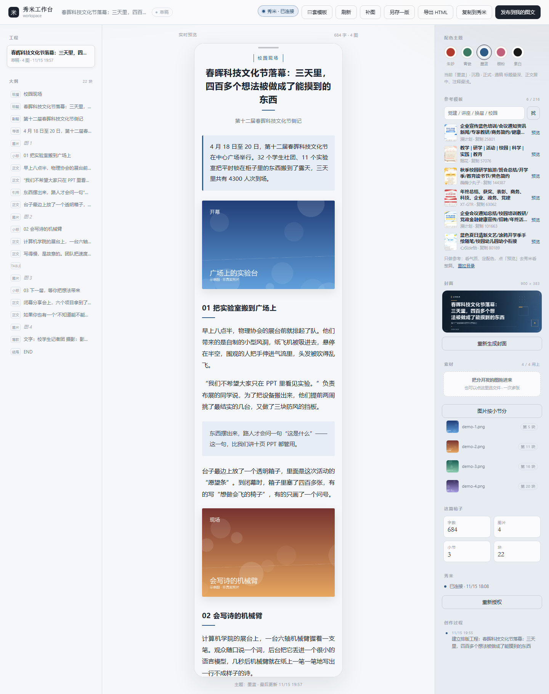
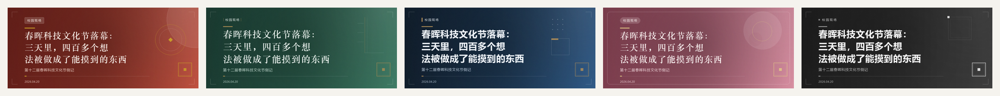

# 秀米图文台 · dsh-xiumi-studio

把前辈发来的 Word 文稿（有时文字和图片分开发）变成一篇排好版的公众号推文，
**在 DSH 右侧栏里全程看得见**，最后送进秀米「我的图文」。

两种用法，同一份界面：

- **DSH 插件**：右侧栏面板 + 16 个能改稿的模型工具（AI 在这套纪律里干活，人随时叫停）。
- **桌面 exe**：不想配 DSH 也能直接双击用；装了 DSH 的话两边看到的是同一份工程、同一套渲染。

它不是"一键生成"的黑盒：结构、配色、封面、每张图的位置都摆在面板里，人可以逐块否决。




## 它能做什么

| 能力 | 说明 |
| --- | --- |
| 收材料 | .docx 直读（段落、内嵌图、表格）；图片分开发就补进「素材」区，按文件名自然序（1,2,…,10）落位 |
| 认结构 | 把一大堆段落分成标题 / 副题 / 导语 / 小节 / 正文 / 引用 / 表格 / 署名；小标题的「一、」「十一、」「01」都认，认不出就原文不动 |
| 语义排版 | 不是"从第一个槽填到最后一个槽"：长标题避开 2.5 倍的大标题槽，单行表转成「表头：值」的分行，图片按小节均匀摊开 |
| 套真模板 | 把账号里已有的模板作品**复制一份**再灌文字与图片，模板的骨架、装饰、动效原样留着；先干跑（零副作用）再真跑 |
| 自挑模板 | 拿这份稿子在每个候选模板里**真排一遍**再打分：空着的小节标题槽、塞不下被并段的、空图片槽最重，题材词命中其次；扣分理由逐条写出来 |
| 自绘版式 | 不套模板也能出一篇：五套配色（朱砂 / 青瓷 / 墨蓝 / 樱粉 / 素白）、按标题自动挑色、引语块 / 图片说明 / 署名 / END 收束 |
| 封面 | 900×383 主封面 + 500×500 分享方图，文字区按主题重排；换主题会提示重绘 |
| 发布 | 图床逐张上传 → 渲染成带 CDN 地址的 HTML → 进秀米「我的图文」；秀米未授权时给授权指引，不假装成功 |
| 留痕 | 每次改块 / 删块都在「创作过程」里留「旧值 → 新值」，人能看到 AI 动了哪一句 |



## 它现在还不能做什么（诚实的那部分）

下面每一条都是真撞过的墙，不是"以后再说"：

1. **免费模板不能凭空套**。秀米的模板是账号内资产：目录里别人模板的 show_id 拿来 `copy_show` 会
   `Common:Failed_DataNotMatch`，`get_show_edit_spec` 直接 `Failed_NotFound`。想套某个模板，
   必须在**登录态的浏览器里手动点一次「使用模板」**把它存进自己账号（这是秀米的权限边界，不是本插件偷懒）。
   想省掉这一步，唯一的路是用 CDP 驱动一个已登录的浏览器去点——**这块还没做完**，是下个版本最想解决的事。
2. **模板的槽位删不掉**。秀米的 `update_show_from_plan` 只能往槽里灌内容，没有删块 / 删槽 / 建新稿的能力。
   模板的槽比稿子多时，多出来的槽只能用零宽空格（文字）和透明细线图（图片）顶掉，
   于是成品里**可能残留一块空面板或一条空色带**。挑模板时按「空槽扣分」避开，但不能杜绝。
3. **exe 没签名**：第一次运行会被 SmartScreen / 某些杀软拦一下，选「更多信息 → 仍要运行」。
   只提供 Windows x64，mac / Linux 没打。
4. **一次一篇**。「另存一版」可以复制出多版对照，但界面上只能同时看一篇，不能左右并排比。
5. **封面和动效是规则生成的**，不是 AI 生图；想要更花的视觉，得自己换图或改 `host/cover.mjs`。
6. **发布最后一步可能仍要人按一下**：跨页注入粘贴事件浏览器不接受，剪贴板在非用户手势下也会被拦。
   走模板真跑这条路是全自动的（作品直接出现在「我的图文」）；自绘版式走"复制到剪贴板 + 人按 Ctrl+V"。

## 下载安装（Windows 桌面版，免安装）

不想配环境、只想双击打开：直接下 **[Releases 里的最新包](https://github.com/27Synthesis/dsh-xiumi-studio/releases/latest)**
（`dsh-xiumi-studio-<版本>-win-x64.zip`，约 150MB；同页有 `SHA256SUMS.txt`，下完可以对一下）。

不想装 exe、只想用插件：把仓库里的 `dsh-xiumi/` 放进 DSH 插件目录（见文末「从源码构建」）。

| 步骤 | 做什么 |
| --- | --- |
| 1 | 解压到手边任意目录（**别**放 `C:\Program Files`，更新时目录会被占用） |
| 2 | 双击 `安装.cmd` → 桌面和开始菜单「程序」里各出现一个「秀米工作台」（不需要管理员权限，可重复执行） |
| 3 | 双击桌面图标就能用；想省事也可以直接双击目录里的 `秀米工作台.exe` |
| 4 | 卸载：双击 `卸载.cmd`（只删快捷方式，稿子和设置留着），再删目录 |

包里两个 exe 别搞混：`秀米工作台.exe` 是**启动器**（带图标、自动补 `--no-sandbox`、清掉
`ELECTRON_RUN_AS_NODE`），`dsh-xiumi.exe` 是 Electron 本体，**直接双击会闪退**（原因见 `desktop/README.md`）。
启动日志在 `%LOCALAPPDATA%\dsh-xiumi-desktop\desktop.log`；起不来时会自己弹一个错误窗口写着日志路径。

装成 DSH 插件，两种都行：

```sh
# 1) 直接装打包好的 tgz（不用克隆仓库、不用装依赖）
dsh plugin add https://github.com/27Synthesis/dsh-xiumi-studio/releases/download/v0.1.0/dsh-xiumi-studio-0.1.0.tgz

# 2) 从源码装：把本目录放进 profile 的插件位置，并在 cordis.patch.yml 里 `- insert:` 挂上 dsh-xiumi-studio
```

装好后面板出现在右侧栏「秀米」，模型侧多出 16 个工具（见下）。

## 三条硬约束（代码里是真的会拦 / 会报的）

| 约束 | 落地方式 |
| --- | --- |
| 文稿文字不删改 | 导入只做「分类与结构」，不改文字；改块接口拒绝把正文改成空串（要清空必须显式带 allowEmpty / allow_clear）；每次改块 / 删块都会在「创作过程」里留下「旧值 → 新值」的记录 |
| 提供的图片必须全部用上 | 导入时按原文顺序逐张落块；一张照片只用一次、不重复堆；`xiumi_preview` 与面板都会点名「未用上的素材」 |
| 成品要进秀米「我的图文」 | 两条路：自绘版走面板「发布」/ `xiumi_publish`（图床 + 剪贴板兜底）；套模板版走 `POST /xiumi/api/template/apply` 真跑，作品直接出现在「我的图文」。秀米未授权时给出授权指引，不假装成功 |

## 三种界面：窄栏 / 宽栏 / 完整工作台

同一份面板有**三种长相**，看你把它放在多宽的地方：

| 你看到的 | 是什么 | 怎么进去 |
| --- | --- | --- |
| 只有手机预览、没有左右两栏 | 右侧栏窄版（< 980px 时自动收起两栏，省地方） | 把右侧栏拖宽到 980px 以上，它会自动变三栏；或点顶栏 **⤢ / 完整工作台** |
| 左边工程+大纲、中间手机、右边主题/模板/封面/素材 | 完整三栏工作台 | 顶栏 **⤢**；或直接开 `/xiumi/studio?session=<会话 id>` |
| 独立窗口 + 菜单栏 | 桌面 exe | 双击「秀米工作台」 |


顶栏按钮：连接秀米 · ⤢ · 补图 · 另存一版 · 导出 HTML · 复制到秀米 · 发布到我的图文
（窄版会藏起刷新 / 导出 / 另存文字，靠图标；窗口窄于 1320px 时三个低频动作收进图标，不会挤出边界）。

## 套真模板（模板的骨架 / 装饰 / 动效原样留住，只换文字和图片）

自绘版式是「我们排的」，套模板是「秀米的模板 + 我们的内容」。两种都在面板里。

| 步骤 | 接口 | 会发生什么 |
| --- | --- | --- |
| 看有哪些模板可套 | `GET /xiumi/api/template/shows` | 列账号里的作品，逐个读 spec 判是不是模板（图片槽 ≥12、文字槽 ≥8），把我们自己的成品认出来剔掉（先按标题认，认不出再按正文认亲） |
| 让它自己挑 | `POST /xiumi/api/template/apply {projectId}` | 先**拿这份稿子在每个模板里真排一遍**再打分：空着的小节标题槽（成品里是空面板，每个 −2）、塞不下被并段的（每段 −2）、空图片槽（每个 −1）最重，其次才是题材词命中与槽位够不够；`picked.reasons` 分加分 / 扣分逐条写出来 |
| 干跑 | 同上 `dryRun:true`（默认） | 只预检，**不在账号里留垃圾稿**，也不往图床传任何东西，返回 `bindings / warnings / report` |
| 真跑 | 同上 `dryRun:false` | 先把只在本地、还没进图床的图传上去，再 `copy_show` 复制模板、灌文字图片，返回新作品号与编辑链接；中途失败会把复制出来的空稿删进回收站 |

排版不是「按顺序一个个填槽」：`host/layout.mjs` 先把稿子拆成标题 / 导语 / 正文 / 小节 / 表格 / 署名，
再按角色找槽（长标题避开 2.5 倍大槽、单行表转置成「表头：值」、**一张照片只用一次**、空着的图槽用透明细线顶掉）。
细节见 `skills/xiumi-studio/SKILL.md` 的「语义排版引擎」一节。

五条要记住的边界（都撞过墙）：

1. **只能套账号里已有的模板**（原因见上文「不能做什么」第 1 条）。
2. **文字槽不能绑空串**（`MATERIAL_EMPTY_TEXT`），清空只认零宽空格 U+200B；图片槽用 1200×2 的透明 PNG 占位
   （1×1 会被撑成正方形大空块）。
3. **未绑定槽原样保留**——模板的装饰就是靠这个活下来的；别顺手全清。
4. **副本标题后缀最多 8 个字**（`copy_show` 的 `title_postfix` 硬限制，超了整次复制 400）。
5. **`/template/fill` 只认本插件复制出来的副本**（登记在 `<工作目录>/.dsh-xiumi/template-copies.json`），
   未登记、跨工程、已发布的都拒绝——不然一次手滑就能把账号里别的稿子洗掉。

## 人怎么用（三步）

1. 把 Word 文件（.docx）拖进对话，或直接说路径；图片分开发就再说一句「图片在同目录 pics/」。
2. 面板会自己弹出来（右侧栏「秀米」），左边是工程与大纲，中间是手机预览，右边是主题、模板、封面、素材、统计、发布。
   大纲是只读的：块怎么挪、图注怎么写，由 AI 按你的话改，改完面板立刻反映（每次改动都记在「创作过程」里）。
3. 图片和文字分开发时：把图拖进右栏「素材」那一块，或按顶栏「补图」；补进来的图默认按小节落到对应位置。
   旧稿的图全挤在文末，就按素材区的「图片按小节分」重排。误拖的图，素材行右上角 ✕ 可以连块一起删。
4. 觉得哪块不对就说：换主题、某张图往前挪、图注改成什么。改完面板立刻变；满意了按「发布到我的图文」。

面板在浏览器里独立打开也可以：`/xiumi/studio?session=<会话 id>`（`xiumi_open` 每次都会把完整地址打出来）。

## 点「连接秀米」被浏览器拦了怎么办

代码已经改成**在你点下的那一刻就把窗口开出来**（等接口返回再开会被浏览器判定成"非用户操作"而拦截）。如果还是被拦：

1. 面板顶部会出现一条黄条：「浏览器拦住了秀米登录窗口 + 手动打开授权页」——**直接点那条链接**，在新标签里登录并点「同意授权」，面板每 1.5 秒查一次状态，连上会自动变成「已连接」。
2. 想从根上放开：点地址栏右侧的「弹窗被阻止」小图标 → 选「始终允许 <你的面板地址> 的弹出式窗口」。
3. 授权只认你本人操作，AI 不能代点。

## 模型侧工具（16 个）

| 工具 | 做什么 |
| --- | --- |
| xiumi_open | 看现场：当前工程、块清单、面板地址。开工第一件事 |
| xiumi_import_docx | Word → 排版工程（解析段落 / 内嵌图，按主题配色，自动出封面） |
| xiumi_add_images | 图片分开发时补图：文件或文件夹，自然序，默认按小节落位（placement=end 放文末，after 指定块） |
| xiumi_layout_images | 旧稿的图挤在文末时，一键按小节重新分开（只挪块，不改素材与文字顺序） |
| xiumi_set_theme | 换配色（zhusha / qingci / molan / yingfen / subai） |
| xiumi_set_block | 调结构与排版：update / move / delete / insert |
| xiumi_make_cover | 重绘封面 900×383 与分享方图 500×500 |
| xiumi_preview | 统计 + 图片落位 + 未用素材检查 |
| xiumi_xiumi_tools | 秀米 MCP 授权状态与真实工具清单（不猜 schema） |
| xiumi_publish | 投递到秀米「我的图文」 |
| xiumi_duplicate_project | 另存一版（深拷贝工程与素材，切到副本，方便比较两种排法） |
| xiumi_remove_image | 去掉误拖进来的素材，连带清掉引用它的图片块 |
| xiumi_templates | 看秀米模板商店的免费图文模板（标题 / 作者 / 复制量 / 预览链接），用来挑气质、定配色；**目录里的模板不能直接套** |
| xiumi_template_shows | 列出这个账号里**能套**的模板作品（已经「使用模板」另存过的），带槽位形状 |
| xiumi_template_apply | 复制一份模板再按槽位灌文字与图片；默认干跑（零副作用），真跑的作品直接进「我的图文」 |
| xiumi_template_fill | 往本插件复制出来的副本里重新灌内容；不是它复制的、跨工程的、已发布的都拒绝 |

## 内置工作流（Skill）

`skills/xiumi-studio/SKILL.md` 是这件事的工作纪律：先看现场 → 收材料 → 定主题 → 只调排版 → 封面 → 自检 → 发布 → 交付话术。
发布前的打勾清单在 `skills/xiumi-studio/references/checklist.md`。

> 这份工作流是**从真实任务里总结的**，不是凭空写的：跑通一篇真稿才写一节，卡在哪就把那一条写进去。
> 它带着四次真稿的经验（自绘版、套模板、带真图、语义排版引擎 + 真排打分）和一张"别做的事"清单。

## 桌面 exe 与插件的关系

| | DSH 插件 | 桌面 exe |
| --- | --- | --- |
| 界面 | 右侧栏面板（同一份 studio 前端） | 独立 Electron 窗口 + 菜单栏 |
| 谁改稿 | AI 通过 16 个工具 | 人在面板里点（AI 不在场也能排） |
| 工程存哪 | `<工作目录>/.xiumi/projects/<id>/` | `<工作区>/.xiumi/projects/<id>/`，启动参数 `--workspace` 可指定 |
| 秀米连接 | 共用同一份 OAuth 凭证 | 同一个授权流程，凭证在 `%APPDATA%` |

两个都装时：exe 打开的是同一份工程目录，改完刷新面板就能看到。

## 已知限制

- 只吃 .docx（.doc 请先另存）；PDF 暂不支持。
- 图片格式限 png / jpg / gif / webp；HEIC 会被明确点名跳过（iPhone 原图常见）。
- 封面是程序画的版式封面，不是 AI 生图；要换图就重排文字区再生成。
- 一篇工程 = 一次推文；多篇并排比较还没做（「另存一版」可以复制出多版对照，但界面上只能同时看一篇）。
- 模板多出来的槽会在成品里留下空面板（原因见上文），挑模板时已按扣分避开。

## 一起把它做得更好

这个项目是一个人为了"每周都要排一篇推文"写出来的。最想找人一起解决的几件事按价值排序：

1. **让"使用模板"那一步自动起来**。现状：只能在登录态浏览器里手动点。目标：用 CDP / 浏览器 lane
   驱动一个已登录窗口，点一次「使用模板」，把模板存进自己账号再交给现有引擎灌内容。
   门槛：要一个已登录且开着调试端口的浏览器。
2. **干掉成品里的空面板**。现状：秀米 plan 接口不能删槽。目标：找到"删块 / 删槽"的合法路径
   （试过 `update_show_from_plan` 的 schema：没有；能否从编辑器 DOM 层面删，未验证）。
3. **更聪明的选模板**。打分已经有了（真排一遍 + 扣分理由），但还是"模板少、题目难"。
   想要：按「稿子结构画像」反向检索模板库，而不是在账号里剩下的几个里挑。
4. **mac / Linux 打包**。Electron 壳是跨平台的，卡在打包脚本只写了 Windows。
5. **回归脚本可移植**。作者本地有一套真的会拦回归的断言（18 个脚本 / 656 条），但它们依赖真实工程固件，
   没随仓库发布——想要一套"任何人 clone 下来就能跑"的 fixture。

怎么贡献：

- 先看 `docs/PRINCIPLES.md`（样式只有一个来源、不写死数值、边界必须显式报错这类约束是真的会被审的）。
- 提 issue 请写清：你用的是插件还是 exe、秀米账号里模板的槽位形状（`xiumi_template_shows` 的输出）、
  期望长什么样 / 实际长什么样（截图最好）。
- PR 请一个改动一件事，对着 `host/` 的改动请说明有没有影响三条硬约束。

## 从源码构建桌面版

```bash
"$PY"   tools/make-icon.py                        # 只在改了图标设计时需要
"$NODE" tools/build-desktop.mjs                   # 从本机 Electron 运行时组装 desktop/dist
"$NODE" tools/build-desktop.mjs --app-only        # 只换壳（改了 host/ 或 client/ 常用这个）
powershell -ExecutionPolicy Bypass -File tools/install-shortcuts.ps1   # 建快捷方式
"$NODE" tools/package-release.mjs --skip-build    # 打发行包 release/*.zip
```

`tools/build-desktop.mjs` 复用本机已装的 Electron 运行时（不联网下载）；`tools/package-release.mjs` 出
`release/<name>/`、`release/<name>.zip`、`SHA256SUMS.txt`。要先有 Node 20+ 与 Python 3（画封面、图标用 Pillow）。

## 目录

```
index.mjs                插件入口：注册路由 / 工具 / 技能，读客户端资源
host/tools.mjs           模型侧 16 个工具（文案即工作纪律）
host/routes.mjs          /xiumi/api/*（状态 / 主题表 / 渲染 / 改块 / 补图 / 模板 / 发布）
host/store.mjs           一个工程一个目录：.xiumi/projects/<id>/
host/docx.mjs            docx 解析 → 块结构（不改文字）
host/images.mjs          素材补录：文件夹展开、重名去重、插块位置
host/layout.mjs          语义排版引擎：把稿子按角色放进模板槽（含表格转行、长标题分层）
host/template-fill.mjs   填槽：spec 解析、绑定计划、干跑 / 真跑
host/template-shows.mjs  账号内模板盘点、成品识别、真排打分
host/render.mjs          唯一的排版渲染源（预览 / 复制 / 导出 / 发布共用）
host/themes.mjs          五套配色 + 按标题自动挑主题
host/cover.mjs           封面绘制（Pillow）
host/presence.mjs        「把面板推到人眼前」的进程内请求
host/mcp.mjs             秀米 OAuth（PKCE）+ JSON-RPC
host/xiumi.mjs           按真实 schema 投递（不猜工具与字段）
client/studio.html|css|js 三栏工作台（?embed=1 为右侧栏窄版）
desktop/app/             桌面壳：主进程（窗口 / 菜单 / userData / 错误窗口）+ 本地 http 服务
desktop/build/icon.ico   应用图标（256…16，由 tools/make-icon.py 生成）
skills/xiumi-studio/     内置工作流（SKILL.md + 发布前 checklist）
docs/PRINCIPLES.md       长期项目的工程约束（样式单一来源、不写死数值…）
docs/PLAN.md             需求 → 实现 → 验收 的可追踪清单（每完成一项回填证据）
docs/E2E-R3.md           一次真实的端到端记录：从 docx 到「我的图文」，含踩过的坑
docs/RELEASE.md          发行说明（这一版改了什么、怎么装怎么卸、怎么打包）
docs/screenshots/        README 用的截图（虚构 demo 工程，不含真实材料）
tools/                   图标 / 打包 / 快捷方式 / 截图脚本
```

开发时的一条坑（值得先说）：`host/routes.mjs` 里有一句 `if (req.method !== 'POST') return fail(res, 405, '方法不支持')`，
它是写方法区的门，**所有 GET 路由必须写在它前面**，否则永远 405。新加 GET 接口时先搜这句话的位置。

## 许可与贡献

MIT，见 `LICENSE`。随包分发的 Electron / Chromium 按其各自许可（`desktop/dist/LICENSE.electron.txt`、
`desktop/dist/LICENSES.chromium.html`）。

欢迎 issue / PR——上面「一起把它做得更好」里列的五件事，任何一件做完都是实打实的改进。
